# SmartCampus – Gestión de aulas y reservas

Microservicio REST para **SmartCampus Solutions** que permite registrar aulas universitarias y gestionar sus reservas, impidiendo reservas solapadas. El proyecto automatiza calidad, tests, construcción de imágenes y despliegue con Git Hooks, Docker y GitHub Actions.

**Equipo:** Mario González Baranda · Jaime Moraleda · Jaime Nicolas Mas

## Arquitectura

```text
Cliente ──► proxy (Nginx :8080) ──► backend (FastAPI :8000) ──► SQLite (volumen /data)
                 └──────────── red smartcampus-net ────────────┘
```

- **backend**: API FastAPI. Capas: `main.py` (HTTP) → `services.py` (reglas de negocio) → `database.py` (SQLite).
- **proxy**: Nginx que publica la API en el puerto 8080. Solo arranca cuando `backend` está *healthy*.
- **Persistencia**: la base de datos SQLite vive en el volumen `smartcampus-data`.

## Instalación

Requisitos: Python 3.11 o superior, Git y Docker Desktop.

```bash
git clone https://github.com/mariete2003/smartcampus.git
cd smartcampus
python -m venv .venv
source .venv/Scripts/activate      # Windows (Git Bash)  |  source .venv/bin/activate en Linux/macOS
python -m pip install -r requirements-dev.txt
cp .env.example .env
sh scripts/install-hooks.sh
```

## Ejecución local

```bash
python -m uvicorn app.main:app --reload
```

Documentación interactiva: http://localhost:8000/docs

## Endpoints

| Método | Ruta | Descripción |
|---|---|---|
| GET | /health | Estado del servicio |
| GET | /rooms | Lista de aulas |
| GET | /rooms/{id} | Consultar un aula |
| POST | /rooms | Crear un aula |
| DELETE | /rooms/{id} | Eliminar un aula (y sus reservas) |
| GET | /bookings | Lista de reservas |
| POST | /bookings | Crear una reserva |
| DELETE | /bookings/{id} | Eliminar una reserva |

### Reglas de negocio

| Regla | Respuesta |
|---|---|
| Capacidad menor o igual que 0 | 400 |
| Hora de inicio no anterior a la de fin | 400 |
| Reservar, consultar o eliminar un aula inexistente | 404 |
| Eliminar una reserva inexistente | 404 |
| Reserva solapada en la misma aula y día | 409 |
| Datos con formato incorrecto | 422 |

## Docker

```bash
docker build -t smartcampus .
docker run -d --name smartcampus -p 8000:8000 smartcampus
curl http://127.0.0.1:8000/health
```

## Docker Compose

```bash
cp .env.example .env
docker compose up --build -d
docker compose ps
```

API en http://localhost:8080 (a través del proxy) y http://localhost:8000 (directa).

## Variables de entorno

| Variable | Uso | Valor por defecto |
|---|---|---|
| `APP_ENV` | Entorno de ejecución | `development` |
| `APP_PORT` | Puerto interno de la API | `8000` |
| `DB_PATH` | Ruta del fichero SQLite | `smartcampus.db` |
| `BACKEND_PORT` | Puerto publicado del backend | `8000` |
| `PROXY_PORT` | Puerto publicado del proxy | `8080` |

`.env.example` se sube al repositorio; `.env` está en `.gitignore` y nunca se sube.

## Tests

```bash
python -m pytest                    # todos (45)
python -m pytest tests/unit         # unitarios (24): reglas de negocio
python -m pytest tests/integration  # integración (21): endpoints HTTP
```

## Git Hooks

Los hooks están en la carpeta `hooks/` (la carpeta `.git/hooks` no se versiona) y se activan con `sh scripts/install-hooks.sh`, que configura `core.hooksPath`.

| Hook | Cuándo | Qué hace |
|---|---|---|
| `pre-commit` | Antes de cada commit | Ruff (lint y formato) y tests unitarios. Si algo falla: Commit rechazado |
| `post-commit` | Después de cada commit | Añade autor, hash, mensaje y fecha a `commit-log.txt` |
| `pre-push` | Antes de cada push | Tests unitarios y de integración. Si algo falla: Push rechazado |
| `post-push` | Después de un push correcto | Muestra rama, commit y remoto, y lo registra en `push-log.txt` |

Git no incluye un hook `post-push` nativo. Se implementa con el alias `git publish`, que ejecuta `git push` (y por tanto `pre-push`) y, solo si termina bien, ejecuta `hooks/post-push`.

## GitHub Actions

Workflow: `.github/workflows/ci-cd.yml`. Se ejecuta en cada `push` y en cada `pull_request` a `main`.

```text
Calidad (Ruff) ──► Tests 3.11 ─┐
               └─► Tests 3.12 ─┴─► Build + validación Docker ──► Deploy (self-hosted)
```

1. **Checkout e instalación** de dependencias.
2. **Calidad**: `ruff check` y `ruff format --check`.
3. **Tests (matrix)**: pytest en Python 3.11 y 3.12 en paralelo.
4. **Build**: validación de `docker-compose.yml` y `docker build`.
5. **Validación**: arranca la imagen y comprueba `/health`.
6. **Publicación**: sube la imagen a Docker Hub (solo en `main`).
7. **Deploy**: el self-hosted runner ejecuta `docker compose up -d --build` y comprueba `/health` (solo en `main`).

- **Variables**: `IMAGE_NAME` y `APP_ENV` en el bloque `env`; el `.env` de producción se genera en el job de deploy.
- **Matrix**: los tests se ejecutan en Python 3.11 y 3.12; el build solo empieza si pasan los dos.
- **Secrets**: `DOCKER_USERNAME` y `DOCKER_PASSWORD` (token de Docker Hub), guardados en GitHub Secrets. No aparecen en el código y GitHub los oculta como `***` en los logs.
- **Despliegue**: GitHub Actions self-hosted runner en un equipo Windows con Docker Desktop (opción A del enunciado). El despliegue es persistente porque los contenedores siguen en marcha en ese equipo al terminar el job.

## Evidencias

### Tests
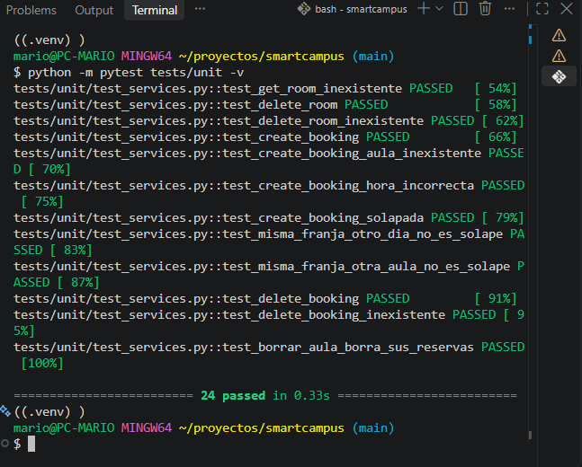
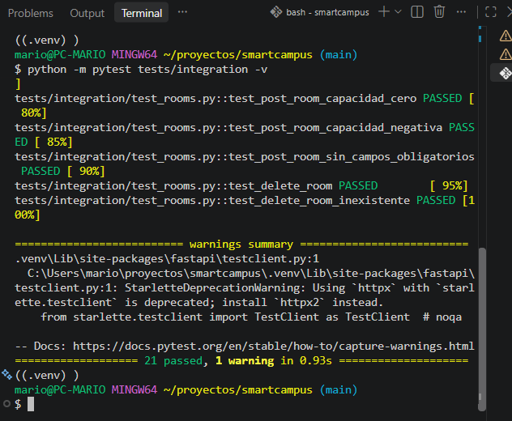
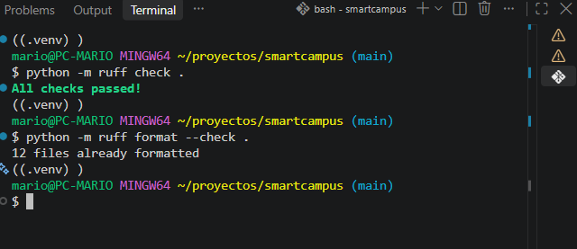

### Aplicación
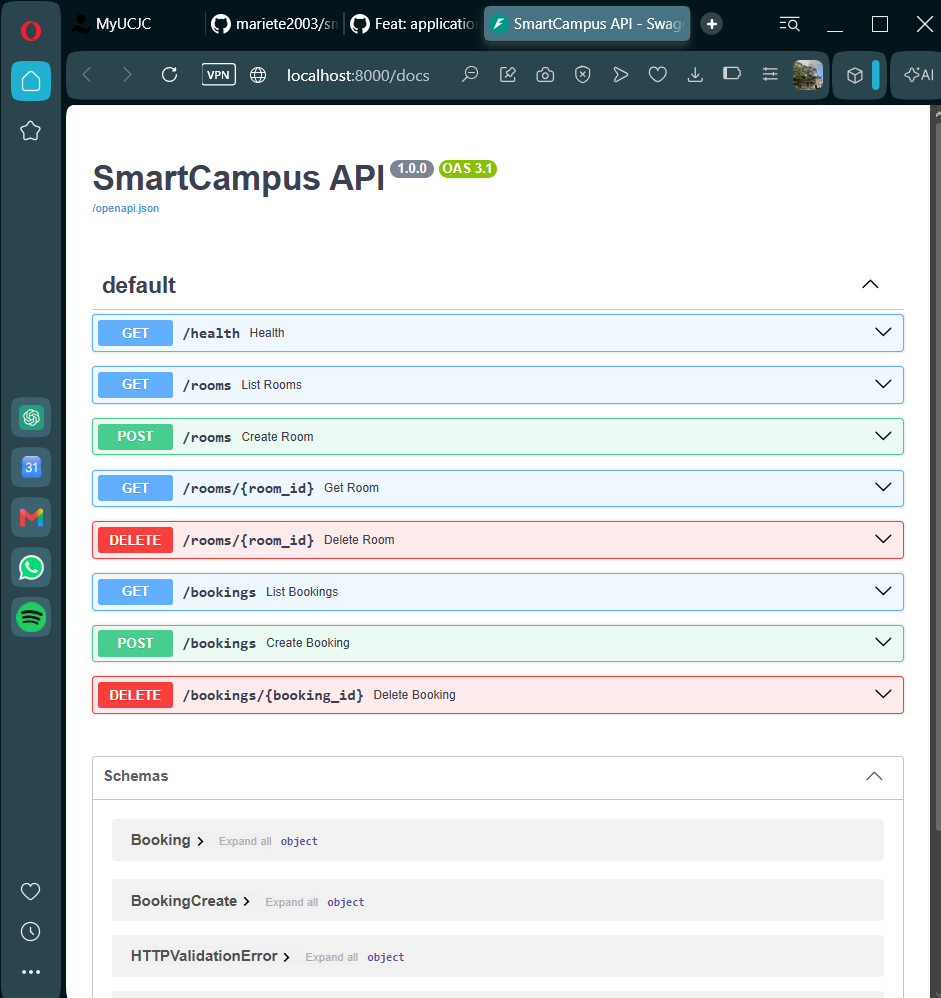
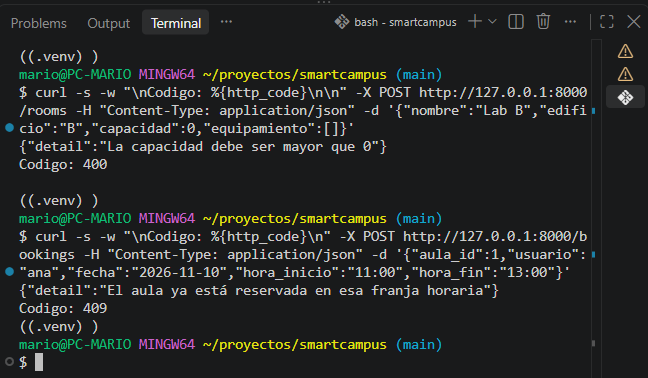

### Git Hooks
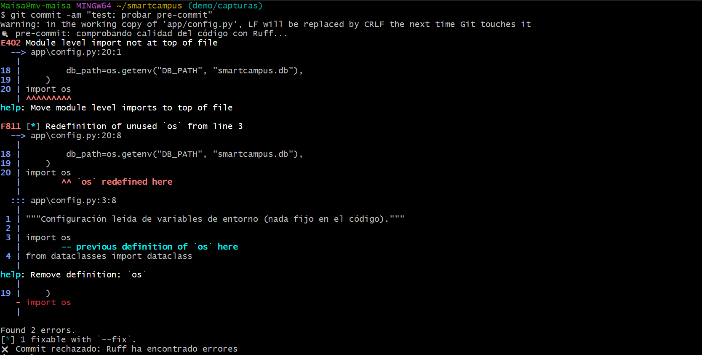
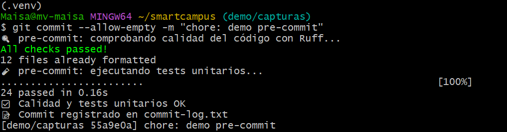
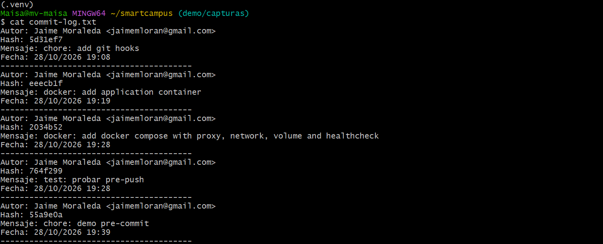
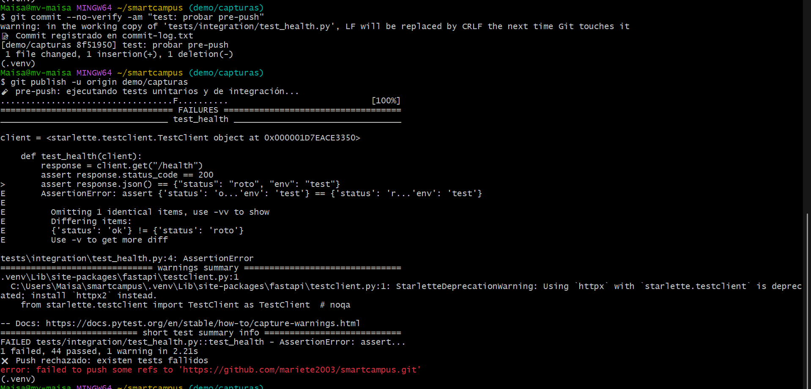
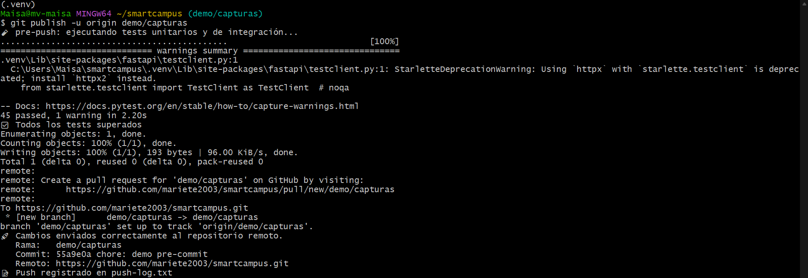

### Docker
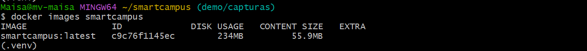
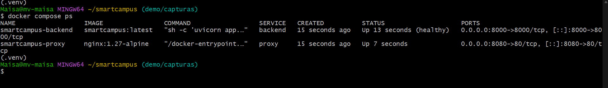
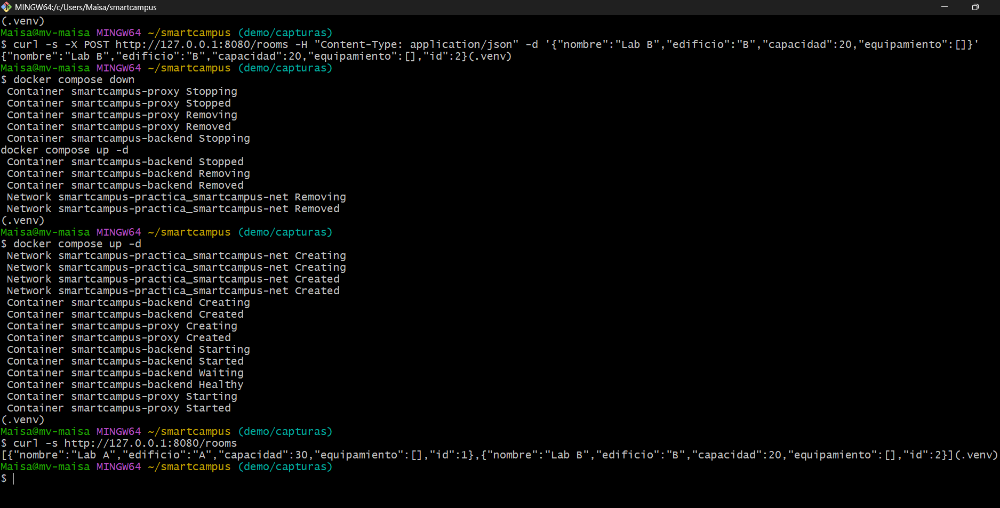

### GitHub Actions
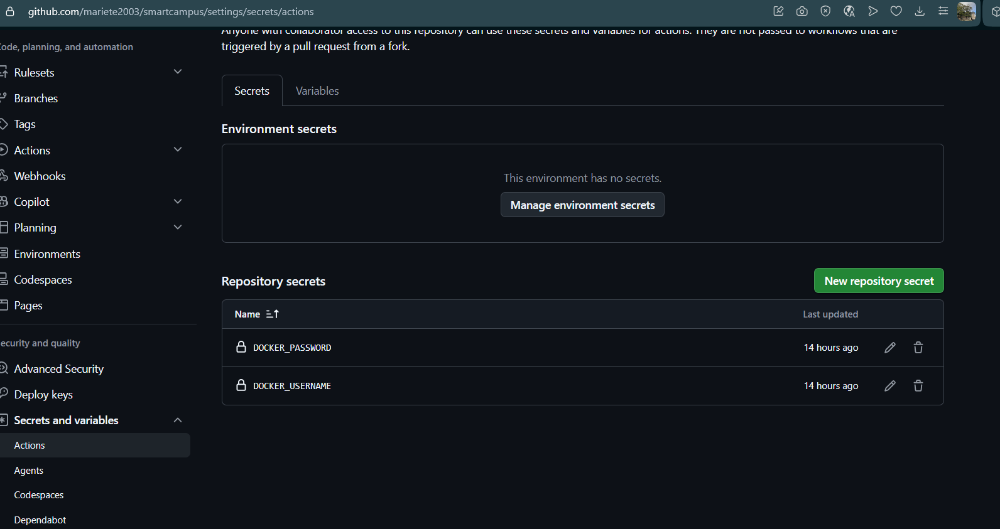
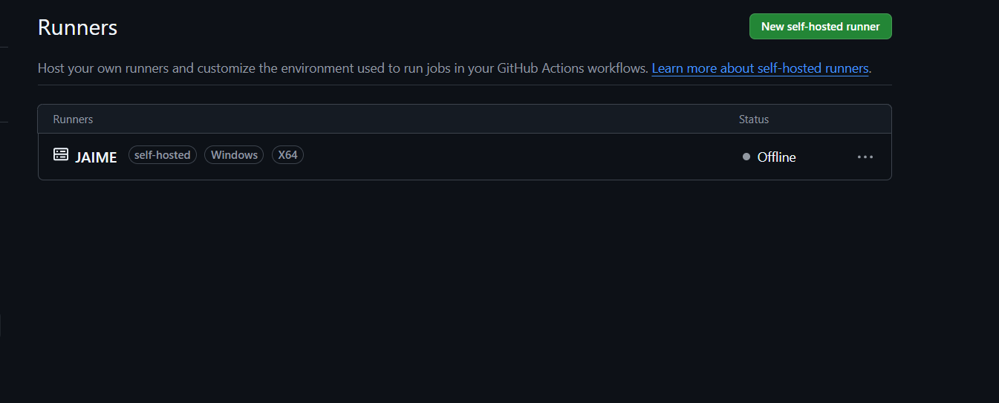
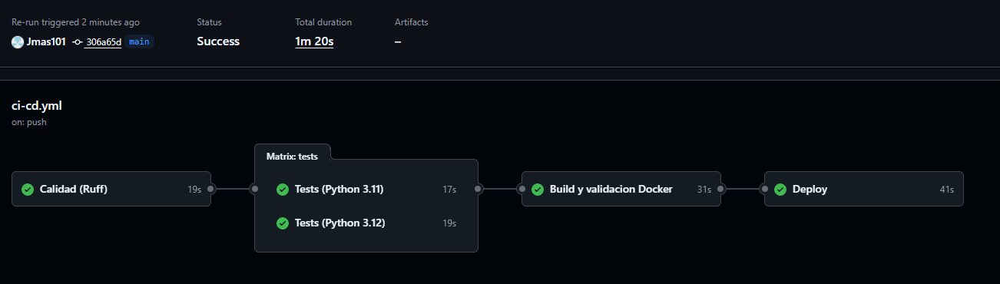
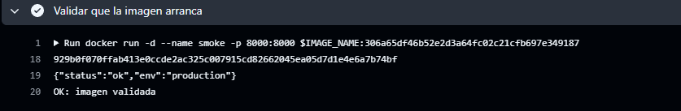
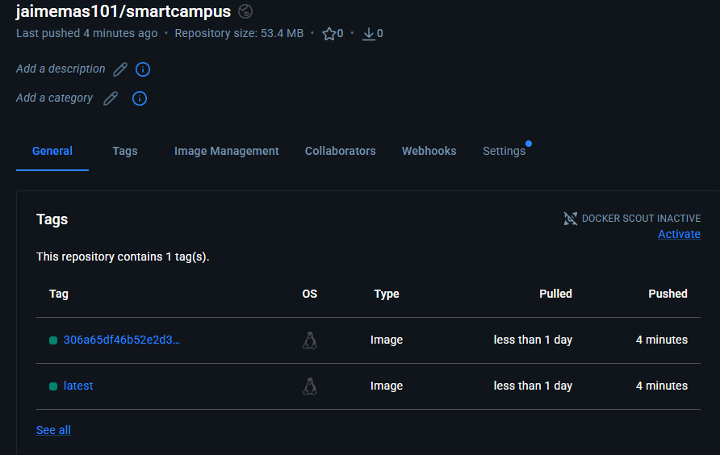
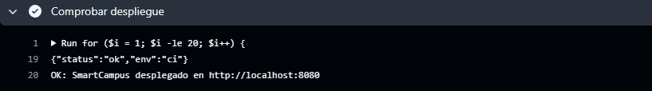
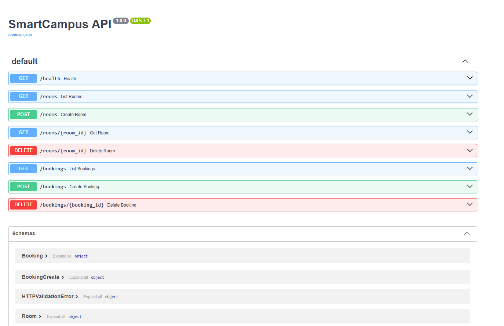
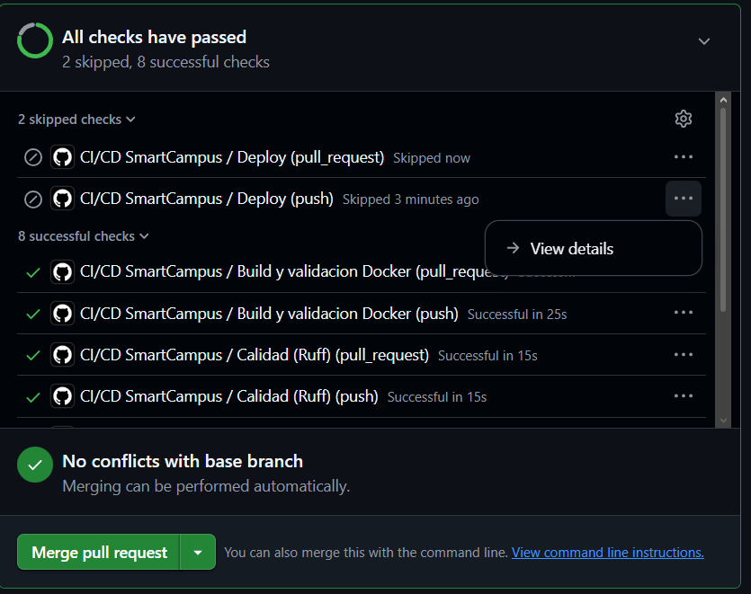
